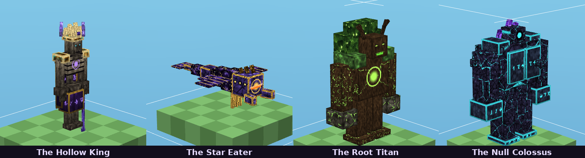
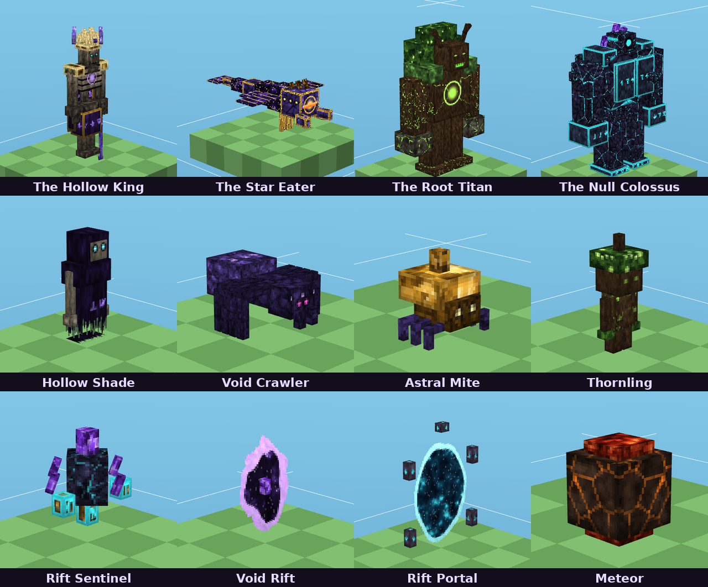
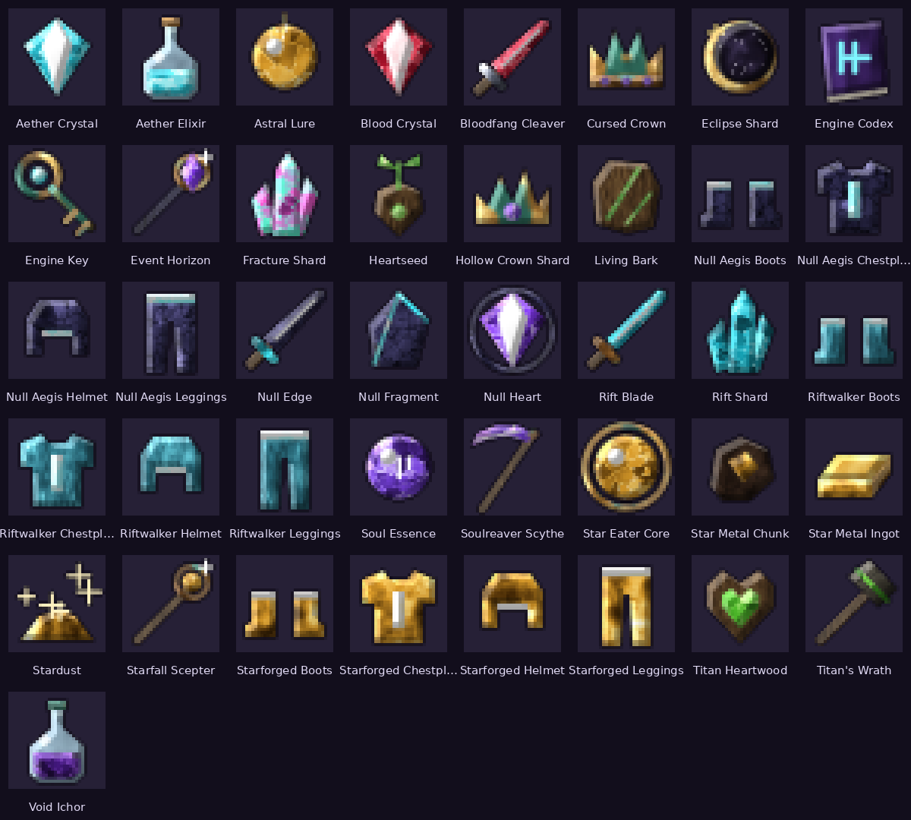

# APOCALYPSE ENGINE

A large Minecraft **Bedrock Edition** add-on, built Android-first: four colossal bosses with real
multi-phase AI, seven dynamic world events, a custom dimension with script-generated floating islands,
and a full gear progression — with original HD art and audio, three mobile performance profiles,
and **no experimental toggles**.



> **Status — read this first.** Version 1.0.0 passes static validation with **0 errors** (≈3,480
> checks, including Mojang's official JSON schemas) and **all automated tests** (unit tests, a strict
> mock-runtime simulation of the compiled scripts across many random seeds, save/reload tests and
> tooling tests). It has **not been played inside Minecraft yet**: no game client or device was
> available while building it. `release/APOCALYPSE_ENGINE_VALIDATION.txt` lists exactly what was and
> was not verified.

Target: Minecraft Bedrock **1.26.30+** (built against 1.26.50) · Script API `@minecraft/server` 2.8.0
and `@minecraft/server-ui` 2.0.0 (both stable) · namespace `apocalypse:`.

---

## What's inside

### Four bosses

| Boss | Summon | Signature mechanics |
|---|---|---|
| **The Hollow King** (600 HP base) | Cursed Crown, at night or during an Eclipse | spectral summons, phantom teleports, jump-to-dodge grave quakes, soul chains, *Crown of Ruin* |
| **The Star Eater** (750 HP) | Astral Lure, at night under open sky | star-bolt volleys, gravity wells, comet dives, a line-of-sight **Supernova** you survive behind cover |
| **The Root Titan** (900 HP) | Heartseed, by day on living soil | telegraphed root eruptions, earthsplitter slams, thornling broods, vine lash, sap shield |
| **The Null Colossus** (1200 HP) | Engine Key + 8 Null Fragments at the Null Gate (Shattered Expanse) | armored (35 % damage) except while its core vents (150 %), gravity lift/slam, sweeping null beam, collapse, orbitals |

Every boss runs a scripted state machine (idle → telegraph → execute → recover) with range checks,
per-attack cooldowns, three phases with invulnerable roaring transitions, health that scales with the
number of nearby players, a leash to its arena, de-duplicated rewards and first-kill bonuses for every
contributor. See [docs/GAMEPLAY_GUIDE.md](docs/GAMEPLAY_GUIDE.md).



### Seven world events

Blood Moon · Void Storm · Meteor Shower · Reality Fracture · Eclipse · Ancient Awakening ·
Corruption Surge. Each changes gameplay (empowered mobs, rifts that drag you in, telegraphed meteor
impacts that leave ore, gravity anomalies, darkness pulses, surfacing treasure caches, poisonous spore
storms), has its own fog/sound/particles, time window, duration and cooldown, rare drops, and cleans
up after itself. Frequency, intensity and each event are configurable.

### The Shattered Expanse — a real custom dimension

Registered through the stable `DimensionRegistry` API (void generator) and built by script: the Nexus
hub, a walkable causeway to the Colossus Arena and procedural floating islands generated around
players in time-budgeted jobs. Reached through rifts opened with the Engine Key.

### Gear and progression

41 items, 14 blocks, 30 recipes: 7 weapons with abilities (Rift Dash, Soul Reap, Earthsplitter,
Gravity Crush, Star Bolt, Gravity Well, lifesteal/bleed), 3 armor sets with set bonuses, summoning
relics, the Engine Key, an Aether Elixir that cleanses event afflictions, ores with Silk Touch/Fortune
support, a Blighted Wilds biome and ancient ruins.



### Visuals (honest version)

Original textures (up to 512²), models, animations, emissive glow layers, 29 custom particles, 7 fog
definitions and synthesized sounds — all generated by this repository's own tools. With **Vibrant
Visuals** the Balanced/Enhanced subpacks add PBR texture sets (MER + normal maps) and biome-scoped
atmosphere/lighting/color grading. **There are no shaders**: Bedrock add-ons cannot ship them.

### Mobile performance profiles

Resource subpacks **Potato / Balanced / Enhanced** (texture resolution, PBR, particle density) plus a
matching script profile (particle multiplier, event-mob caps, boss adds, meteors per wave, Expanse
generation budget, boss update rate), changeable in the Engine Codex.

---

## Install (Android)

1. Download `release/APOCALYPSE_ENGINE.mcaddon` and tap it → open with Minecraft.
2. In a world: activate **APOCALYPSE ENGINE [Behavior]** (its resource pack comes along).
3. No experiments needed. Pick a subpack via the resource pack's gear icon.

Full guide (troubleshooting, uninstall): [docs/INSTALLATION.txt](docs/INSTALLATION.txt) /
`release/APOCALYPSE_ENGINE_INSTALLATION.txt`.

## Commands

`/apocalypse:codex` · `/apocalypse:event start|stop|status [event]` · `/apocalypse:profile <potato|balanced|enhanced>` ·
`/apocalypse:summon <boss>` (operators; summon also needs cheats).

---

## Build from source

Requirements: Python 3.10+ with `numpy` and `pillow`; Node.js 18+; `ffmpeg` with libvorbis (only to
regenerate sounds). Optional: `jsonschema` + `referencing` and a checkout of
[Mojang/bedrock-samples](https://github.com/Mojang/bedrock-samples) for official-schema validation;
Mojang's Creator Tools (`npx @minecraft/creator-tools`) for an independent validation pass.

```bash
npm ci
pip install numpy pillow jsonschema referencing
python3 build.py                                   # generate → compile → test → validate → package
python3 build.py --schemas ../bedrock-samples      # + official JSON-schema validation
python3 build.py --mct "$(which mct)"              # + Creator Tools validation
```

The build writes the six deliverables to `release/` and re-opens every archive to verify it.
Individual steps: `python3 tools/generate_all.py`, `npx tsc -p tsconfig.json`,
`node --test tests/*.test.mjs`, `python3 -m unittest discover -s tests -p "test_*.py"`,
`python3 validate.py`.

## Project layout

```
behavior_pack/     entities, items, blocks, recipes, loot, spawn rules, features, biome, structures, compiled scripts
resource_pack/     client entities, models, animations, render controllers, attachables, particles, fogs,
                   sounds, textures, VV configs, subpacks/{potato,balanced,enhanced}
src/scripts/       TypeScript sources (bosses/, events/, items/, world/, ui/, core/, logic/)
tools/             deterministic generators for every asset + schema checker
tests/             logic unit tests, strict mock runtime (tests/mock), simulation, reload and tooling tests
docs/              installation guide, gameplay guide, previews
build.py           one-command build; validate.py static validator
TECHNICAL_DESIGN.md · FEATURE_MATRIX.md · CHANGELOG.md · RELEASE_NOTES.md
```

## Testing

* **Logic** — boss state machine, event scheduler, reward ledger, progression, profiles, island
  generation (including a check that the Nexus→Arena causeway is continuous).
* **Runtime simulation** — the compiled `main.js` runs on a strict mock of `@minecraft/server`
  that rejects unknown identifiers, undeclared entity properties/events, invalid effects/sounds/
  particles/fogs, early-execution world access and restricted-execution API calls. Scenarios: every
  event, every boss fight, abilities, relics, armor, ores, the Expanse (with a flood-fill proving the
  Arena is reachable on foot), the Codex and commands, and six in-game days of natural scheduling.
* **Persistence** — a world saved mid-event and mid-boss-fight resumes correctly.
* **Tooling** — `.mcstructure` codec and validator, including planted defects it must catch.

These tests found real bugs during development (listed in [CHANGELOG.md](CHANGELOG.md)). They are not
a substitute for play-testing.

## Known limitations

No in-game testing yet; balance is untuned by real play; custom dimension terrain is script-built
(the engine only offers a void generator); PBR/fog volumes need Vibrant Visuals; no shaders. Details:
[TECHNICAL_DESIGN.md](TECHNICAL_DESIGN.md) §8 and the validation report.

## Credits and licensing

All textures, models, animations, particles and sounds were generated by the code in `tools/` for this
project; no Mojang or third-party assets are included. Mojang's sample packs and JSON schemas were
used locally for validation only and are not redistributed. Unofficial add-on — not affiliated with
Mojang Studios or Microsoft. "Minecraft" is a trademark of Mojang Synergies AB.
